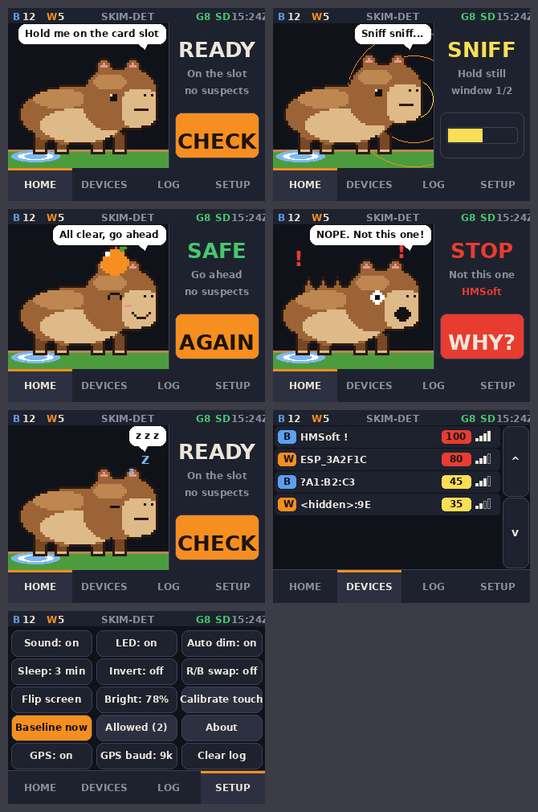

# Skimmer Detector, CYD edition

The same detector as the XIAO build, on an ESP32-2432S028R "Cheap Yellow Display" (the 2-USB revision with USB-C and micro-USB). Touch UI, a capybara that sniffs for you, and the hit log on the microSD. No wiring: everything used is on the board.



## Hardware

| Part | Notes |
|------|-------|
| ESP32-2432S028R, 2-USB | ESP32-WROOM-32, 4 MB flash, no PSRAM. ST7789V panel on most units, ILI9342 on recent AliExpress batches |
| microSD (FAT32) | optional; the log and allow list go here when present |
| Power | USB-A to C, or micro-USB. The USB-C port has no CC resistors, so a C-to-C cable will not power it |
| GPS (optional) | Any NMEA module (ATGM336H, NEO-6M/7M/8M, BN-220) on the CN1 header, 9600 baud by default |

Board pins the firmware uses (fixed by the board, see `src/board.h`): display SPI 14/13/12, CS 15, DC 2, backlight 21; touch XPT2046 bit-banged on 25/32/39, CS 33, IRQ 36; SD 18/19/23, CS 5; RGB LED 4/16/17; speaker 26; LDR 34. P3 is free.

GPS wiring on CN1 (4-pin 1.25 mm, order on the board: GND, GPIO22, GPIO27, 3V3):

| CN1 pin | GPS module |
|---|---|
| 3V3 | VCC |
| GND | GND |
| GPIO22 | TX (module transmits, ESP receives) |
| GPIO27 | RX (optional, only needed to configure the module) |

With a fix, every alert and every completed check is stamped with latitude, longitude, satellite count and UTC time, and the status bar shows `G8` (green, 8 satellites) and the GPS clock. Yellow `G` means NMEA is arriving but there is no fix yet; red `G` means nothing on the UART (check baud and that TX went to GPIO22). GPS can be turned off and the baud changed on the Setup tab. Tapping a LOG row shows the coordinates it was logged at.

## Build and flash

```
cd cyd
pio run -t upload            # from source
```

or write `../firmware/skimmer-detector-cyd-1.0.0-cyd2usb-full.bin` at offset `0x0` with esptool or https://espressif.github.io/esptool-js/ (ESP32, 4 MB).

ILI9342 panel: build with `-DPANEL_ILI9342=1` in `platformio.ini`. If colours look wrong on either panel, use the Invert and R/B swap buttons on the Setup tab instead of rebuilding; both are saved.

## Using it

1. Power on. The capybara is awake and listening. Standing a few feet from the register, open Setup and tap **Baseline now** (5 s). Optional: each completed check becomes the comparison for the next one anyway.
2. Hold the board on the card slot and tap the capybara or **CHECK**. It sniffs for 10 s (one more window if the result is ambiguous).
3. **SAFE** (green, chime) or **STOP** (red, three low beeps, the screen flashes). STOP needs a real signature: module name, UART service, vendor OUI, handshake, or a device that is both very close and got markedly stronger since the previous check. Proximity alone never produces STOP.
4. **WHY?** on a STOP opens the device list at the offender.

Tabs along the bottom:

| Tab | What is there |
|-----|---------------|
| HOME | The capybara, the verdict, the check button. Tap the capybara to start a check |
| DEVICES | Everything scored 30+, sorted by score. Tap a row for the id, RSSI, the reasons for the score, PROBE (BLE P/M handshake) and ALLOW |
| LOG | Alerts (score 60+). Mirrored to `/skimlog.csv` on the card. CLEAR wipes RAM and the file |
| SETUP | Sound, LED, auto-dim (LDR), sleep timer, invert, R/B swap, flip screen, brightness, touch calibration, baseline, allow list, about, GPS on/off, GPS baud, clear log |

The capybara naps after 45 s on the Home screen; any tap wakes it. After the sleep timer (default 3 min) the board deep sleeps; touching the screen wakes it (PENIRQ on GPIO36). Sleep is held off while a check is running or a STOP is on screen.

## SD card files

| File | Contents |
|------|----------|
| `/skimlog.csv` | `boot,uptime_s,utc,kind,id,name,score,rssi,factors,lat,lon,sats,hdop` one row per alert |
| `/checks.csv` | `boot,uptime_s,utc,verdict,device,hits,lat,lon,sats` one row per completed check |
| `/allow.txt` | one id per line; this copy wins over the NVS copy when the card is present |

`boot` is a counter kept in NVS, so rows from one power cycle can be told apart. `utc` and the location columns are empty until the GPS has a fix; `uptime_s` is always there since the board has no RTC.

## The capybara

Frames are 64x48 indexed PNGs in `art/`, drawn on the screen at 3x. States: `idle` (3 frames: breathe, breathe, blink), `sniff` (3), `safe` (2), `stop` (2), `sleep` (2).

- `tools/make_capy.py` draws the stock frames (PIL).
- `tools/frames2header.py` packs `art/<state>_<n>.png` into `src/capy_frames.h`. Run it after changing any PNG, then rebuild.
- `tools/mockup.py` renders `art/_ui_preview.png`, an approximation of the screens.

To use your own character: export each frame as a 64x48 PNG with transparent background (alpha, or pure magenta), name them `idle_0.png` ... and so on, and run `frames2header.py`. Colours are snapped to the 16-entry palette at the top of that script, so a Blender render will posterise; either paint with those colours or change the palette in both scripts (16 entries max, entry 0 is transparent). The speech lines live at the top of `src/ui.cpp`.

## Differences from the XIAO build

- Touch instead of buttons. The 2-mode simple/maintenance split is gone; the full device list is a tab away.
- Hit log is 60 entries in RAM plus the CSV on the card (the XIAO kept 24 in NVS).
- Allow list is saved to both NVS and `/allow.txt`.
- Bluetooth Classic (HC-05/06) is still not scanned. The WROOM has the radio for it, but BLE + BT Classic + WiFi together overflow IRAM on this chip; that is a separate experiment.
- Deep sleep wakes on touch rather than a button. Current draw in deep sleep is dominated by the board's own LDO and the CH340, so expect hours on a battery, not weeks. A GPS module on CN1 keeps drawing its ~25 mA through sleep (there is no power control pin on the header); put a switch in its 3V3 lead if that matters.

## Memory

Static RAM about 56 KB, flash about 1.24 MB of the 3 MB `huge_app` slot. The scene is a 200x180 4-bit palette sprite (18 KB); the rest of the screen is drawn directly.
